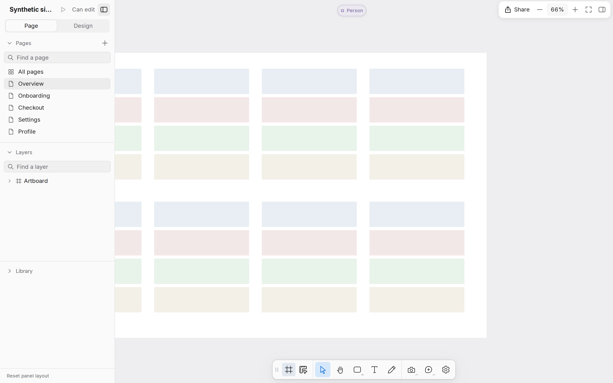
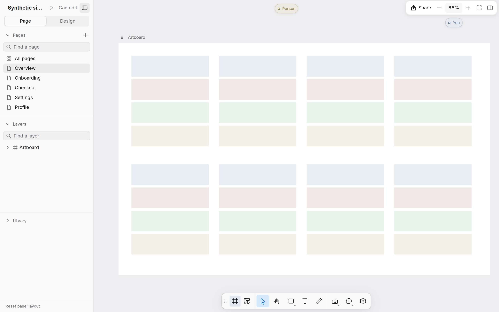

# A moved badge stays clear of the corner bars — refs #20

On `main`, a participant badge could be dragged under the floating top-right bar (Share and zoom). The bar is drawn above it, so the badge could not be seen. Keyboard Home still recovered it, but a double-click could not reach it.

The test used two participants on a disposable synthetic Paper: the owner and a local edit guest whose invitations had no code and were revoked afterwards. It was served by `node server/server.mjs` with isolated storage and viewed in Chrome headless shell through the T3 preview. Both images are the guest at 1280 × 800 and 66%, with Pages open and Properties closed. Each was taken after a real drag of the guest's own badge onto the zoom level. Before is `main` (69b2d1d); after is this branch.

## Before

## After

| Check (after) | Observed |
| --- | --- |
| Drop on the zoom level, 1280 × 800 | Shown 8 px below the bar (y 46) with the same x. The other badge did not move. |
| Drop on Share, then on the floating Paper title (Pages closed) | Each is shown just below that bar. |
| Shift+Arrow Up while under the bar | Stays below it. Moved left beside the bar, it goes to the top (y 8), where it was put. |
| 390 × 700, and a panel swap there | On `main` the badge was under the bar. Here it is shown below the bar, and the saved place does not change. |
| Back to 1280 × 800 | The badge returns to its saved place beside the bar. |
| Home | Puts the badge back in the strip. |
| Paper and other browsers | The Paper's revision did not change. The owner's tab saved no positions, and its badges stayed unmoved. |

`tests/agent-motion-ui.test.mjs` covers the drop, the narrow window and its return, a bar docked over its panel, and Home. It fails on `main`.

Not covered here: the Codex and Claude Code host views. The one-time heartbeat stop noted on #20 is unrelated and was not changed.
