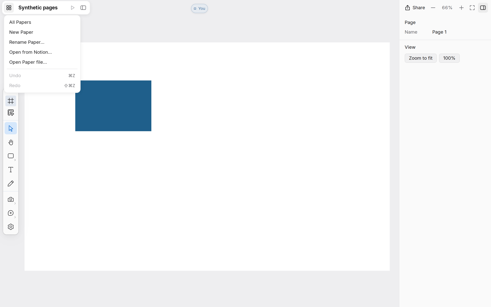
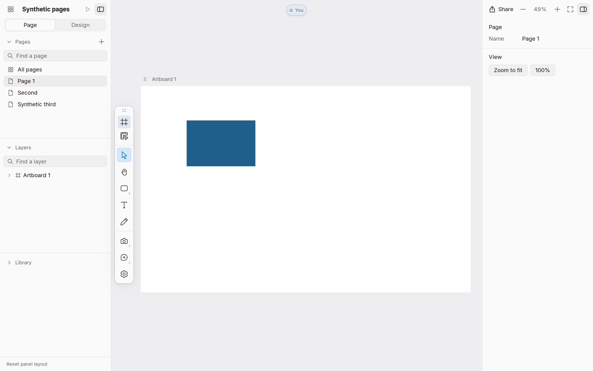

# Canvas navigation and human Page management — issue #21

Browser check of #21 on `main` (7b57704; runtime identical to ba941dc), on a disposable synthetic Paper ("Synthetic pages": one rectangle on Page 1 and a second Page) served by `node server/server.mjs` with isolated storage, in Chrome headless shell through the T3 preview at 1280 × 800, light theme. The owner's 14 November decision applies: there is no separate house control.

## Paper menu instead of a Home control

The four-square Paper menu holds All Papers, New Paper, Rename Paper…, the Open routes and Undo/Redo. No house icon is present.

## Pages and recovering the view

| Flow | Observed |
| --- | --- |
| Zoom to fit after panning about 12,000 px away (panels closed) | Artwork returns to the same place at 66%; a second press changes nothing |
| Zoom to fit after a far pan with the Pages panel open | Artwork fitted inside the free canvas (x 403–551 within 240–1040) at 49% |
| New page | "Synthetic third" created and selected with its name in rename; Enter commits |
| Navigate | Selecting Second makes it current |
| Delete page | The menu item asks again, naming the page and its layer count ("Delete “Synthetic third” and 1 layer?"); the second press deletes it |
| Undo (Paper menu) | The page comes back in its place and is current |
| Reopen | After reload the saved Paper has Page 1, Second and Synthetic third with the same ids |
| Edit guest (local invitation, no code) | Paper menu and All Papers hidden; `home.html` and the owner's sharing overview answer 401 |

Automated coverage of the same contracts: `tests/canvas-navigation.test.mjs` (fit, panels, empty Page, no house control, panel width) and `tests/page-crud.test.mjs` (names, refusals including the last page, undo/redo, persistence, editor wiring).

Not covered here: the native Codex and Claude Code views, and their back/return through the host's Home.
