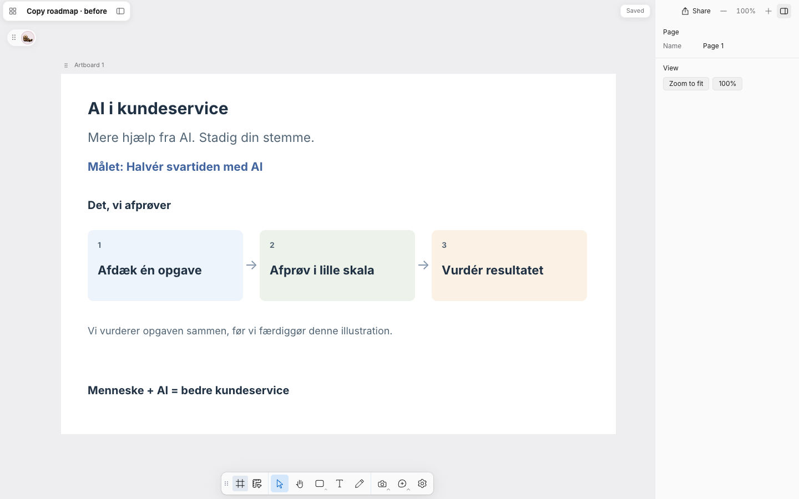
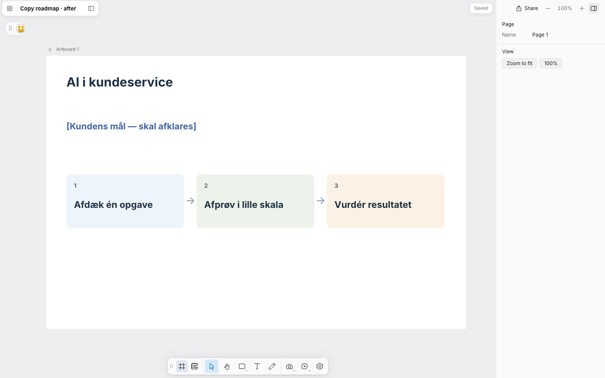
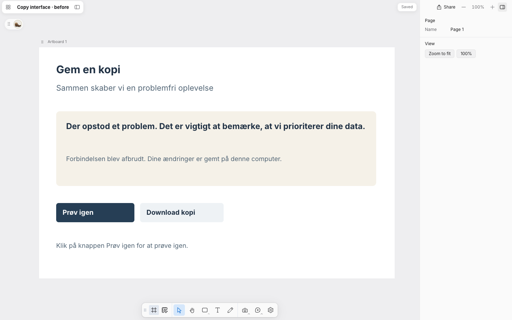
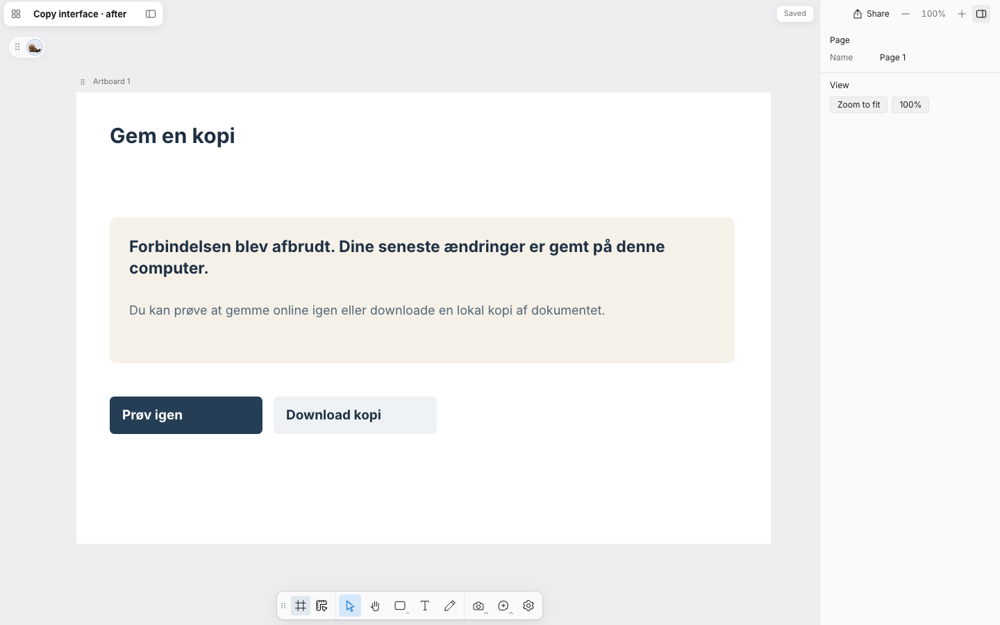

# Paper Copy validation — issue #8

The actual bundled Design/Diagram and Copy instructions were forward-tested by an ephemeral read-only Codex worker (gpt-6.1-sol, high), given raw briefs rather than expected answers. The parent checked the results against the approved facts, then rendered the roadmap and interface as editable native text layers in disposable Papers using the current editor. Screenshots were visually inspected at 100%; no clipped or overlapping labels. Originals remain separate from revisions. These are editorial fixtures, not evidence of a live network failure or production campaign.

| Brief | Observed result |
| --- | --- |
| Roadmap | Kept the three supplied steps; replaced an unsupported goal with a visible Danish placeholder; removed unsolicited slogan, authoring commentary and repeated formula. |
| Interface | Kept interrupted-connection and local-save facts, retry and download actions; clarified recovery and removed generic reassurance and repeated click instructions. |
| Campaign poster | Kept the exact approved slogan “Mere hjælp fra AI. Stadig din stemme.” and action; removed an unsupported guaranteed-success claim. This deliberately uses the same slogan removed from the roadmap: context determines the decision. |
| Process diagram | Kept proposal status, Browser/API/Document store, PUT path, matching-revision condition and 409 rejection. Removed author commentary without hiding uncertainty. |

## Roadmap

## Interface message

This checks representative behavior and rendered readability, not universal detection of AI-written text. Native Codex menu clicks and real Notion OAuth still need owner acceptance. Source selection and licenses are recorded in the bundled Copy skill references.
