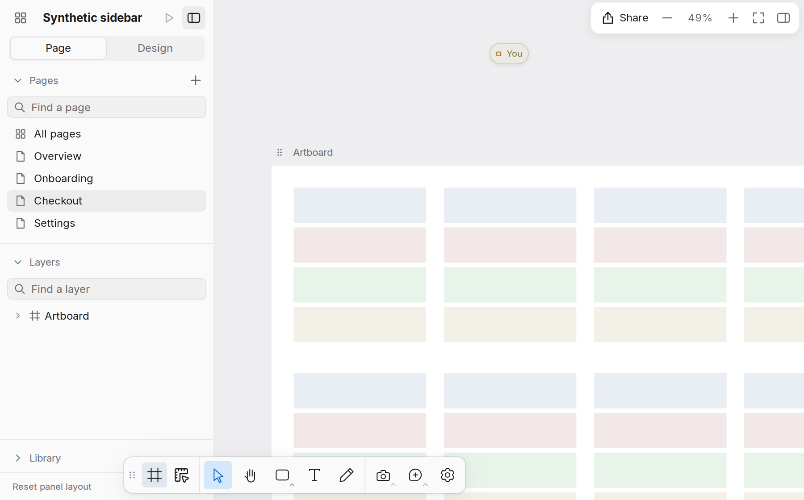
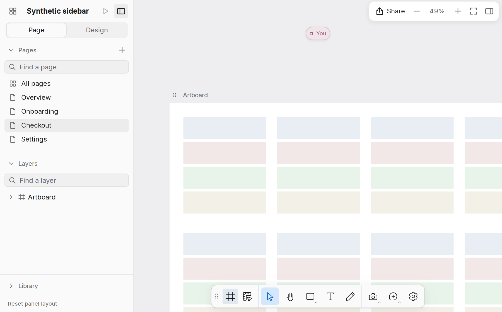

# Toolbar after a panel swap in a compact window — refs #9

Below 1024 px only one side panel is open at a time, so opening Pages closes Properties. The canvas then moves 240 px to the right at the same width. On `main` the toolbar was only placed again when the canvas changed size, so it stayed where it was and covered about 100 px of the Pages panel, over Library and the section dividers.

Both images come from the same disposable synthetic Paper ("Synthetic sidebar", 8 Pages, 41 layers each), served by `node server/server.mjs` with isolated storage, in Chrome headless shell through the T3 preview at 900 × 560. Each shows real clicks on Properties and then on Pages. Before is `main` (e2dad49); after is this branch.

## Before

## After

| Window | Panels, in click order | Toolbar centre vs canvas centre (before → after) |
| --- | --- | --- |
| 900 × 560 | Properties → Pages | 330 vs 570 → 570 vs 570 |
| 1280 × 800 | Pages only, both, Properties only, none, Pages only | Already centred on `main`; unchanged |

`tests/canvas-navigation.test.mjs` runs the editor's own docking bounds against a panel swap that keeps the canvas size, and it fails on `main`.

Not covered here: the Codex and Claude Code host views.
