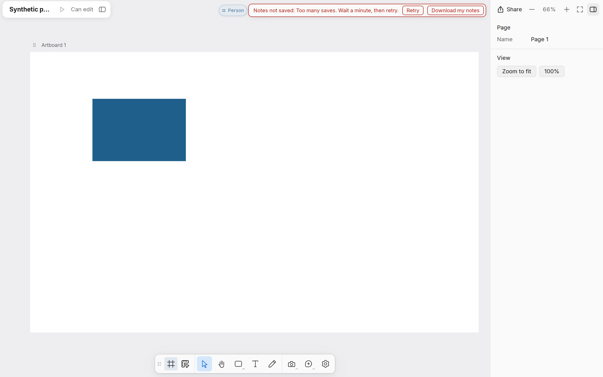
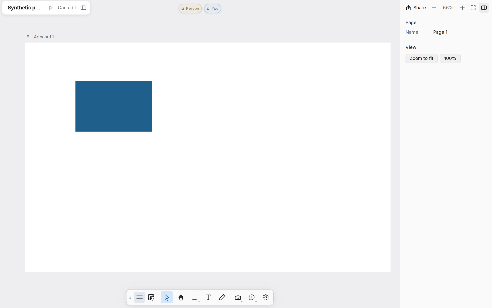

# Feedback sync between an owner and an edit guest

An owner and an edit guest with the same Paper open at the same time, on a disposable synthetic Paper ("Synthetic pages") in the browser editor with isolated storage. Chrome headless shell through the T3 preview, 1280 × 800. The guest joined through a local invitation without a code; neither person changed anything.

| | `main` (7b57704) | This branch |
| --- | --- | --- |
| Feedback requests, owner tab | 8 per 5 s, continuously | 2 in total (read and first save), then none |
| Feedback requests, guest tab | 9 per 5 s, continuously | 1 in total (read), then none |
| `feedback.json` | rewritten alternately by both tabs | written once |
| Guest status | "Edited", then after about a minute "Notes not saved: Too many saves. Wait a minute, then retry." | none |
| Leaving the page | asks for confirmation in both tabs | no prompt |

## Edit guest, before

## Edit guest, after

Cause: the toolbar saves the page it shows with empty defaults and other pages as `{}`. The owner (`/?paper=…`) and the guest (`/?invite=…&paper=…`) show different page keys, so their bytes differed although neither held any feedback, and each save made the other reload, mount and save again. `tests/feedback-sync.test.mjs` runs the editor's save path for both sessions: it settles after the first save, and a real comment and its removal are still saved and kept.

Not covered here: the native Codex and Claude Code views.
