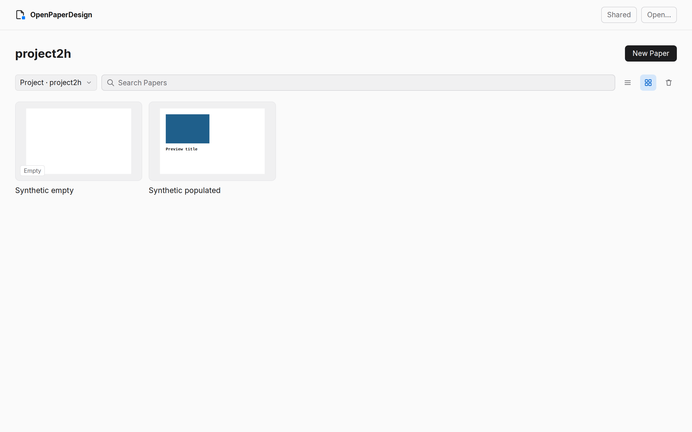
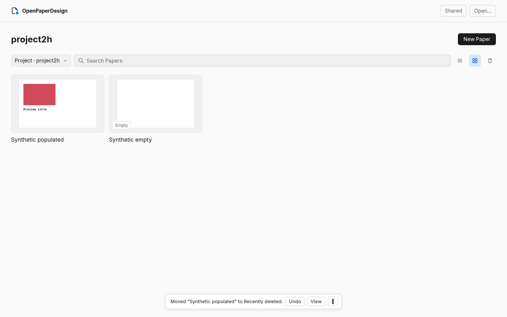

# Home previews, Trash and Undo — issue #2

A browser check on `main` (bc55038). It used disposable synthetic Papers in a project library, served by `node server/server.mjs` with isolated storage, in Chrome headless shell through the T3 preview at 1280 × 800, and at 390 × 800 for the compact layout.

## A populated and an empty Paper

## Move to Trash, with Undo

| Check | Observed |
| --- | --- |
| Populated versus empty | The populated Paper's card shows its artwork; the empty Paper's card shows a blank board marked **Empty** |
| Refresh after an edit | After the artwork changed through the API (blue → red), the card showed red on the next Home load. Home reloads on focus, when the tab becomes visible, and every 15 s |
| Refresh after an import | Open… → Import Paper file… opened the imported Paper. Back in Home, it had its own card and preview: blue, from the bundle, next to the edited red original |
| Move to Trash → Undo | A confirmation names the Paper and says its sharing links stop first. The notice "Moved … to Recently deleted." with Undo, View and Dismiss appears at the bottom centre. The cards do not move, and Undo has keyboard focus. Enter restores the same Paper id with the same preview |
| Move to Trash → Recently deleted → Restore | The Recently deleted button opens the list. Restore brings back the same Paper id with its preview, and the dialog says so |
| 390 px | The cards use two columns. The Undo notice fits inside the window (16–374 px) without horizontal scrolling |

Automated coverage: `tests/home-previews.test.mjs` (empty, hidden, stale thumbnails, size budget, escaping, files byte-identical through Trash/Restore) and `tests/home-server.test.mjs` (Trash ends only that Paper's invitations; Restore does not bring them back).

Not covered here: the native Codex Home surface. The thumbnail's text and the ✕ glyph use fallback fonts in this headless browser.
