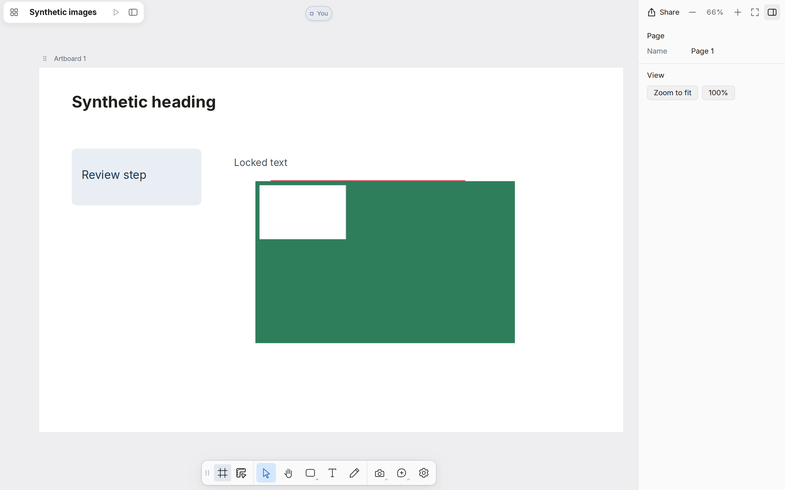
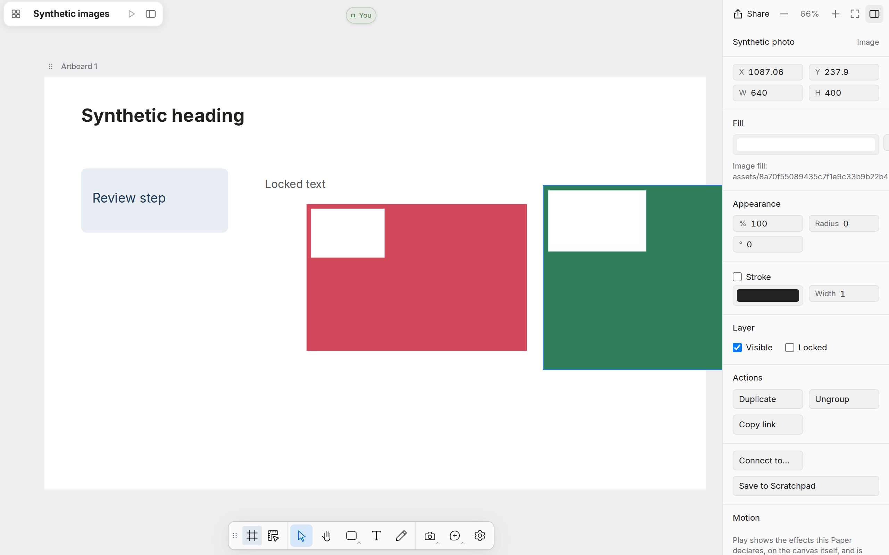

# Dropping several images — issue #18

A real Chromium drop event on a disposable synthetic Paper, in the browser editor with isolated storage, through the T3 preview at 1280 × 800 and 66% zoom. The drop carried three files at once: a 480 × 320 PNG, a 640 × 400 JPEG and a broken PNG. Before is `main` (6fc655c); after is this branch.

| Check | Observed (both builds unless noted) |
| --- | --- |
| Navigation | The tab stays on the editor; the drop is handled |
| Message | "Added 2 images. Not added: broken.png could not be opened as an image." |
| Stored bytes | Each asset's SHA-256 equals the dropped file's, and the original names are remembered (`Synthetic red.png`, `Synthetic photo.jpg`) |
| Undo, redo, reload | One undo removes the last image; redo restores it; both are kept after a reload |
| Placement on `main` | Both are centred on the drop point and stepped 28 px. The larger JPEG covers nearly all of the PNG, so one image appears to be missing |
| Placement on this branch | The first image is centred on the drop point and the second follows to its right, 24 px apart on screen. Both are visible |

## Before

## After

Not covered here: the native Codex app, Copy image pasted into another app, and Save image… to a chosen folder on a Mac.
