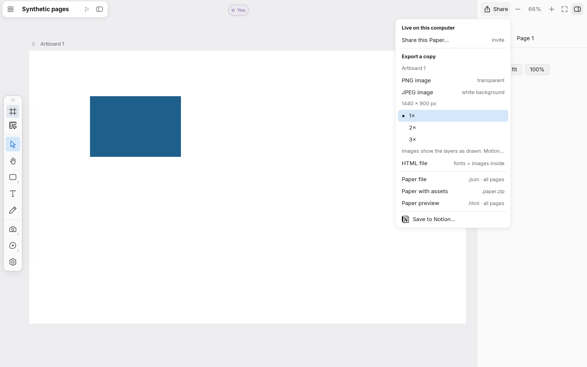
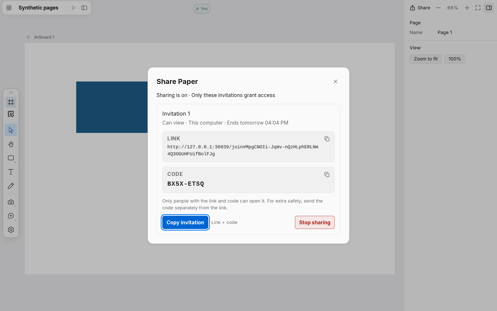

# Share menu and dialog by keyboard — issue #19

Keyboard run on a disposable synthetic Paper in the browser editor with isolated storage, in Chrome headless shell through the T3 preview at 1280 × 800 (the menu and dialog were also checked at 390 px). Before is `main` (02b8698); after is this branch.

| Step | `main` | This branch |
| --- | --- | --- |
| Share button, Enter | The menu opens on the export scale "1×", in the middle of the menu | The menu opens on its first action, Share this Paper… (guests: PNG image) |
| Create invitation, Enter | Focus leaves the dialog (`document.activeElement` is `body`) | Focus waits on the status line while it runs, then lands on the new invitation's Copy invitation |
| Copy link, code or invitation | The row is rebuilt and focus is lost | Focus stays on the same control |
| Stop sharing, Enter | Focus is lost when the row goes | Focus moves to the form's first field |
| Escape or Close | Focus goes to the canvas | Focus returns to the Share button |

Pickers that open on their current choice are unchanged: the shape flyout still opens on the selected shape and the canvas menu on its selected background.

## Menu opened by keyboard, before

## Menu opened by keyboard, after

## After Create invitation

Not covered here: the native Codex and Claude Code views, and a real Internet (Cloudflare) invitation.
