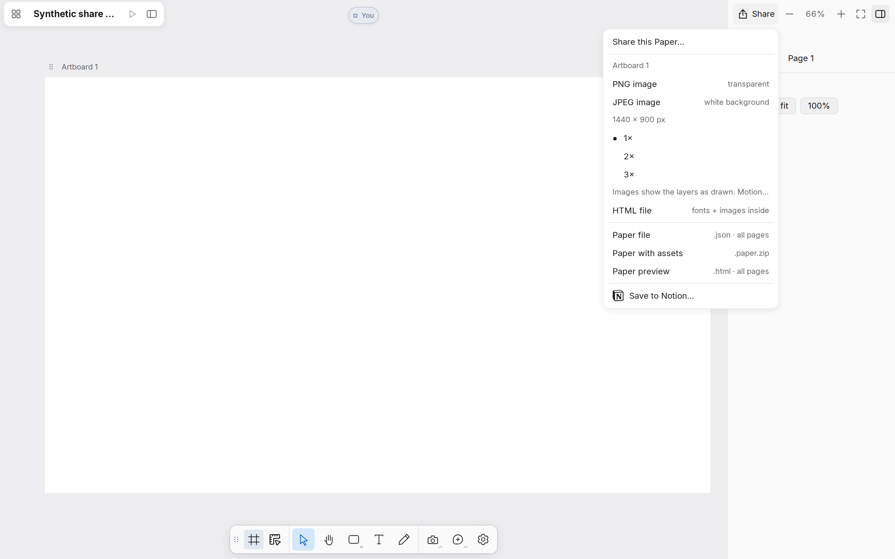
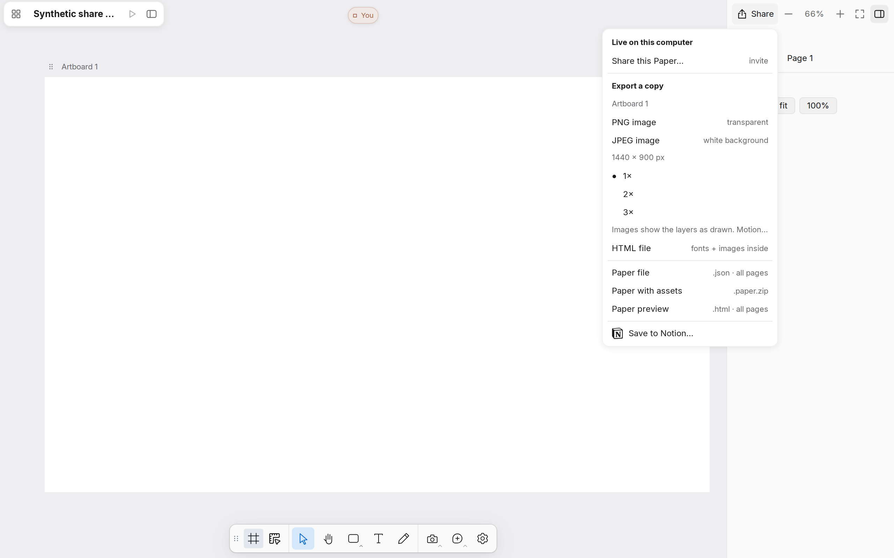

# Share menu: live Paper versus exported copy — issue #24 (first slice)

Both images show the owner's Share menu on the same disposable synthetic Paper ("Synthetic share menu", one empty artboard), in the browser editor served by `node server/server.mjs` with isolated storage. Same viewport (1280 × 800 CSS px), light theme and 66% zoom. The only other difference is the anonymous presence avatar, which each new browser session picks at random. Before is `main` at 44d4e7b; after is this branch.

## Before

## After

Also exercised on the after build:

- **Owner:** Share this Paper… is still the first keyboard stop and opens the same Share Paper dialog. Arrow Down moves from it to PNG image; the headings are not focus stops.
- **View guest and edit guest** (local disposable invitations without a code, revoked when the server stopped): the menu lists the same exports as before (PNG, JPEG, scales, HTML, Paper file, Paper preview) under the Export a copy heading. Share this Paper…, Paper with assets and Save to Notion stay hidden.
- **390 px wide:** the menu stays inside the window and neither heading is cut off.

This is browser evidence on Linux (Chrome headless shell through the T3 preview). It does not cover the Codex or Claude Code host views.
