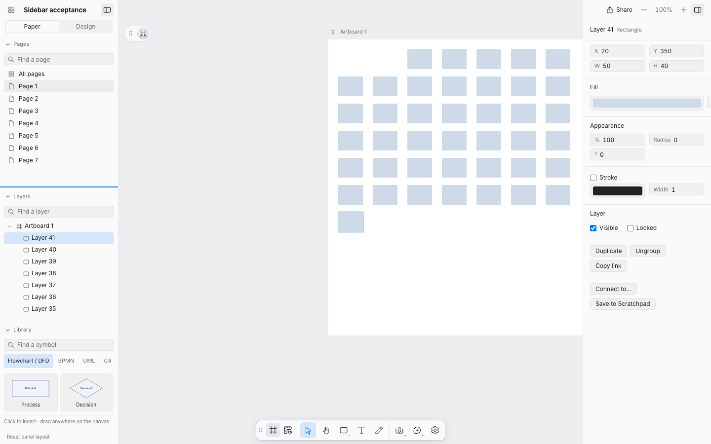
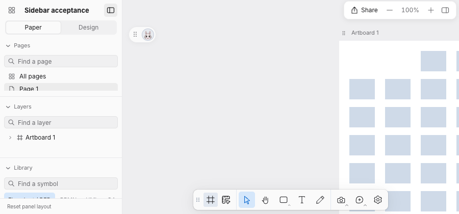

# Sidebar validation — issue #9

Pages, Layers and Library now share a docked, collapsible panel system with matching headings, padding and search controls. The owner requested a single divider line: each boundary has one visible line with an 8px pointer target, a row-resize cursor and keyboard focus feedback. Pages gains filtering without changing the current page.

## Observed in real Chromium

Disposable Paper: seven pages, each with an artboard and 41 child layers. At 1440×900, pointer dragging expanded Pages enough to show every page row and returned space to Layers when reversed. Arrow keys adjust by 16px, Shift+Arrow by 48px, Home/End reach the allowed limits. Minimum expanded heights are Pages 112px, Layers 112px and Library 216px; collapsed headers are 32px.

The document API response, selected layer, active page and camera transform were identical before/after the resize, limit keys and Library expansion. Delete, R and Cmd+Z on a panel control did not edit artwork or trigger Inspection/feedback shortcuts. Space/Enter activate section headers. Pages scrolls independently of Layers. Page search includes empty results and Escape-to-clear; Library search remains functional.

Local allocation and expansion preferences survived reload. Collapsing Layers joined Pages/Library with an operable divider; restoring it retained usable allocation. Reset restored the defaults. At 900×420, the section stack scrolled rather than shrinking below its minimums (315px viewport, 456px content). Each list retains independent overflow. Library remained inside the left panel and did not cover the canvas. Save to Scratchpad revealed the Paper tab and Library from both the Design tab and a closed sidebar, focused search, and displayed the saved symbols.

An independent read-only review found capture-shortcut leakage and hidden Scratchpad opening; both were corrected and exercised in Chromium. Follow-up review reported no concrete findings. Four durable geometry/preference tests cover transfer, limits, compact overflow, collapse and invalid stored values. Native Codex menu interaction remains outside this browser proof.

