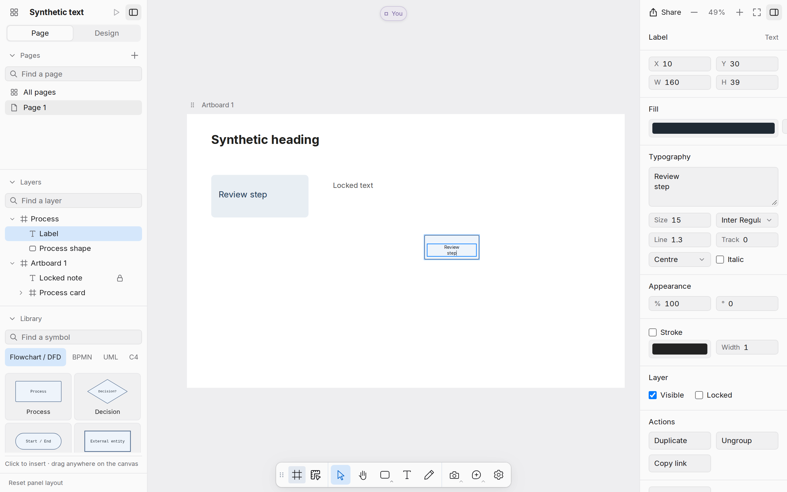

# Direct text editing on the canvas — issue #6

Browser check on `main` (0b78baa), on a disposable synthetic Paper ("Synthetic text") served by `node server/server.mjs` with isolated storage. It ran in Chrome headless shell through the T3 preview at 1280 × 800. The Paper holds a standalone heading, a nested frame with a text label over an opaque card background, a locked text layer, and a **Process** symbol inserted from the Library (a `flow-process` diagram group, as in the original report).

| Check | Observed |
| --- | --- |
| Single click on the Process label | Selects the Process symbol (the group) |
| Double-click on the same label | Opens an inline editor on that text layer, focused, at 49%, 66% and 100% canvas zoom |
| Typing | The new text shows in place while typing; Enter adds a line ("Review" / "step") |
| Ctrl+Enter | Commits; the saved Paper has the label as the same native `text` layer inside the symbol, with `"Review\nstep"` |
| Escape | Restores the text from before the edit, on screen and in the file |
| Undo, then redo (Ctrl+Z, Ctrl+Shift+Z) | "Process", then "Review\nstep", both saved |
| Reload | "Review\nstep" is kept |
| Export | The Paper file (`.json`) has the edited native text layer; the HTML export shows "Review"/"step" and no stale "Process" label |
| Symbol position | Unchanged through all edits (x 781.26, y 397.90) |
| Locked text, double-click | No editor opens; the text is unchanged |
| Standalone heading | Double-click opens the editor; Escape restores "Synthetic heading" |

Automated coverage of the targeting rules: `tests/text-targeting.test.mjs` (nested targets, opaque covers, locked and hidden ancestors).

Not covered here: browser page zoom (Ctrl/Cmd +/−), which this headless preview cannot set, and the native Codex view.
