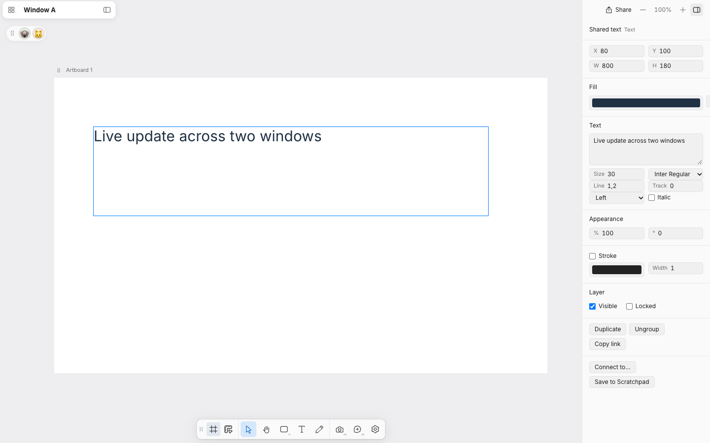
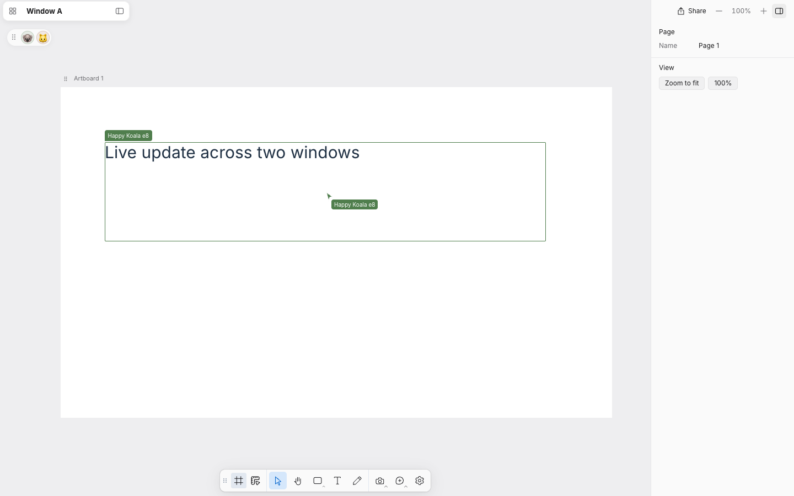
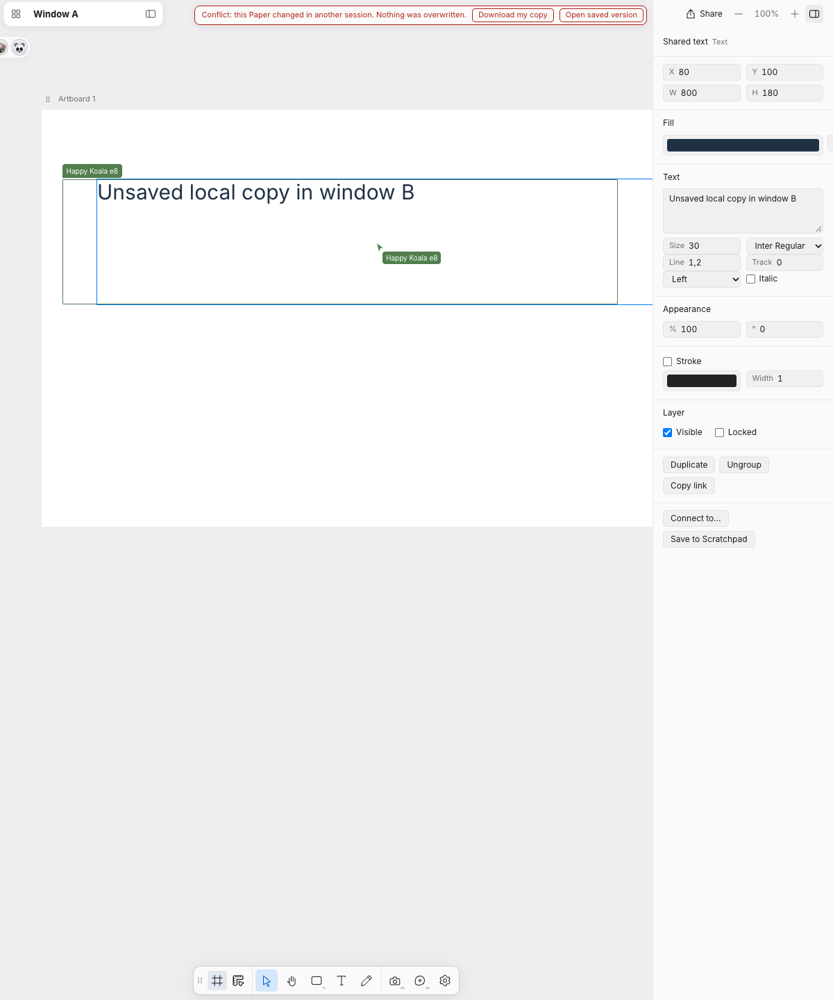

# Workspace version and multi-window validation

The reported failure came from package-version equality checks in discovery, Home links, native navigation and the native owner API proxy. A live preview.12 workspace was rejected by newer clients before opening a Paper.

The owner API and document contract now have explicit capability versions, independent of the renderer/package version. Known shipped previews 12–16 predate those fields and are narrowly supported as legacy API-1 servers. Explicit incompatible capabilities, unknown legacy versions, wrong origins and stale instance IDs remain rejected. No automatic stop, port takeover or data migration is performed. Existing TCP election still chooses one listener. The open-tool result reports the actual backend version separately from the client version. Compatible reuse does **not** upgrade an old backend or qualify new backend features such as Notion status changes.

## Observed browser behavior

The current preview.17 native renderer ran in a standalone Chromium iframe host using its real Paper UI bridge. Its backend was the actual preview.12 source from commit 85e800113ad12a6605ad5916b39517d8680225bd in a disposable library. This exercises the native bundle and owner proxy, not Codex's desktop menus.

- Two native surfaces opened different Papers simultaneously; editing one preserved the other.
- Both surfaces then opened the same Paper and converged on a saved text change through the normal live update path.
- Closing the second surface left the first usable and the backend running.
- With a local text edit pending in window B, saving in A followed by committing B produced the conflict UI. The saved winner remained on disk, while B retained its local text and offered Download my copy. Nothing was overwritten.

## Other verification

A read-only check used preview.17 discovery and its native owner proxy against the actual live primary preview.12 server (GET /api/status only). The primary app and backend were not restarted, stopped or written to.

Four durable tests cover capability boundaries, reuse through the UI proxy, revision-checked simultaneous writes, no automatic stop, stale-instance rejection, simultaneous startup election and retained nonce-bearing Home resource URIs across preview updates. Review identified the retained-URI case; it was fixed and regression-tested.

Real-account native Save to Notion is still an owner acceptance check. A compatibility test against preview.12 must not be described as a test of the new Notion backend. Existing Fermentary artwork was not used or modified by these synthetic tests.
